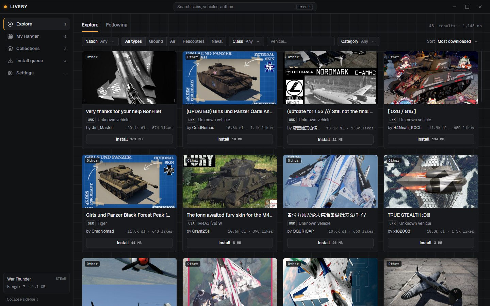
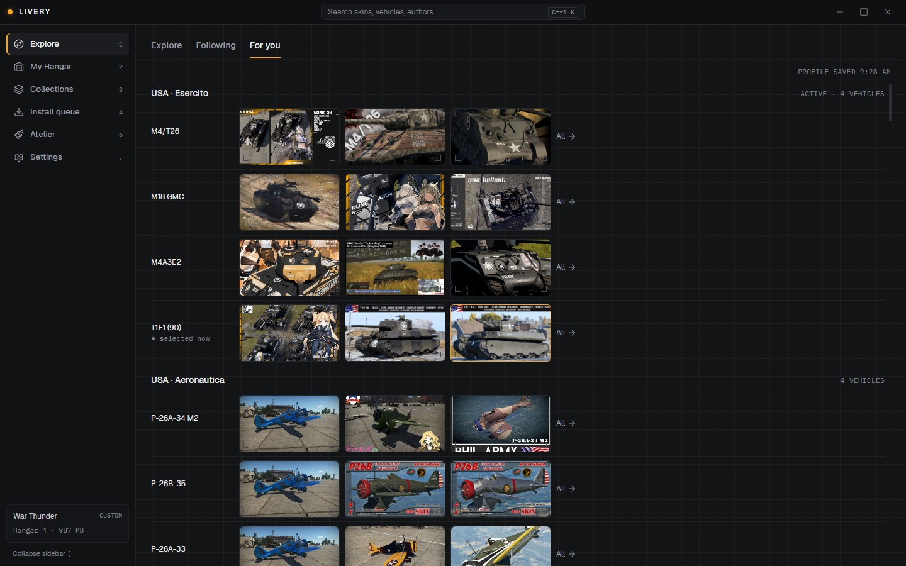
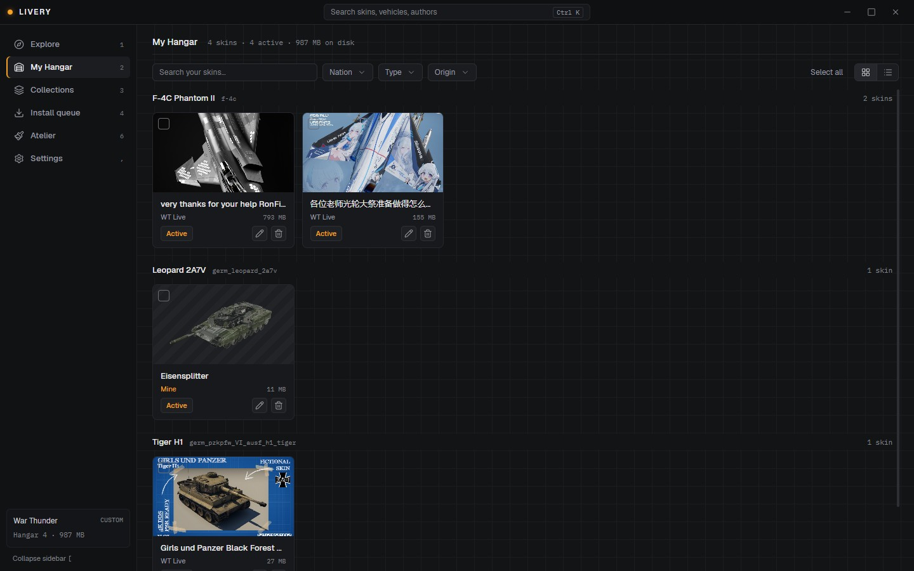

  

# Livery

**A free skin manager for War Thunder on Windows.** Browse community skins from WT Live, install
them with one click, and keep your `UserSkins` folder tidy.

  
   
  Windows 10/11, 64-bit · free · <a href="https://github.com/Pier144/Livery/releases/latest">release notes and other files</a>

> **Unofficial tool, not affiliated with Gaijin Entertainment.** War Thunder and WT Live are
> Gaijin's. Every skin belongs to its author: Livery shows who made it and links to the original
> post.

## What it does

- **Explore WT Live**: search, filter by nation, type, class and vehicle, follow authors and
  vehicles, and see what's new from them.
- **For you**: skins for the vehicles in your War Thunder lineups, active lineup first, with the
  most downloaded ones and what's new since your last look.
- **Install with one click**, or **try a skin in the game first** and keep it only if you like it.
- **Install from files**: drop a ZIP, 7z or RAR (or a folder) on the window, or let Livery watch
  your Downloads folder. Packs with several skins install every skin, each for its own vehicle.
  RAR archives open with the 7-Zip or WinRAR installed on your PC.
- **My Hangar**: every installed skin with its picture, grouped by vehicle. Turn skins on and off,
  rename them (the name you see in the game's customisation menu changes too), uninstall them, and
  undo any of it.
- **Collections**: sets of skins you can switch on together.
- **Checks** each skin for missing textures and problems in its `.blk` file.
- **Updates itself**: it tells you when a new version is out, and can install it for you.
- In English, Italiano, Deutsch, Русский, Français, Español, Polski, Português (Brasil) and 简体中文,
  with vehicle names as the game writes them in your language. It starts in your Windows language.

## Install

1. Download the installer with the button above (or `Livery_<version>_x64-setup.exe` from the
   [latest release](https://github.com/Pier144/Livery/releases/latest)).
2. Run it. It installs for your Windows user only and doesn't need administrator rights.
3. **"Windows protected your PC"**: the installer isn't code-signed yet, so Microsoft SmartScreen
   doesn't know it. Choose **More info → Run anyway**. Every release lists the installer's SHA-256
   so you can check the file, and updates are verified with Livery's own signature before they
   run.
4. On first launch Livery finds your War Thunder install (Steam or standalone) and offers to add
   the skins already in `UserSkins` to your Hangar.

Needs Windows 10 or 11 (64-bit) with the WebView2 runtime, which Windows 11 already has.

**Updates:** Livery checks for a new version a few seconds after it opens and asks you. In
Settings → Updates you can check by hand, or let it download new versions in the background and
install them when you close it.

**Uninstall:** Windows Settings → Apps → Livery. The installer offers to delete Livery's own data;
your skins in the game's `UserSkins` folder stay where they are.

## Privacy

No account, no ads, no telemetry. Livery connects only to:

- **WT Live** (`live.warthunder.com` and its image server `cdn-live.warthunder.com`), when you
  browse, open or install skins. It asks politely: one request a second at most, cached for a day,
  and never anything from Gaijin's Marketplace. You can turn WT Live off in Settings → WT Live.
- **GitHub**, to check for and download Livery updates.
- **GitHub, only if you use Remove background in Atelier** (experimental, off by default): ONNX
  Runtime (Microsoft) and the isnet-anime model are downloaded once, when you ask and after you
  agree, and kept on your PC. Your pictures never leave it. Settings → Experimental shows their
  size and removes them.

**Send feedback** (Settings → About, or the command palette) doesn't send anything by itself: it
opens a pre-filled page on GitHub in your browser, which you submit there with your GitHub account.
You see exactly what the page will hold first. Technical details (Livery and Windows version,
language, the last lines of the log with folders and your user name hidden) are attached only if
you leave that box checked.

Your settings, library and collections stay on your PC. Skins go only into the game's `UserSkins`
folder; Livery doesn't change any other game file.

**Reading the game's files.** To recognise which vehicle a skin is for, Livery reads the vehicle
names from the game's own data files (read-only, on your PC; nothing is changed or sent anywhere).
For the For you tab it also reads your lineups from your War Thunder profile
(`Documents\My Games\WarThunder\Saves\…\global.blk`): only the lineups and the selected
vehicle, nothing else from that file, and nothing leaves your PC. If you prefer it didn't, turn off
Settings → Game → "Read data from the game": Livery then uses a smaller built-in list, recognises
fewer skins and has no suggestions in For you.

## Questions and problems

- **A skin doesn't show in the game:** in War Thunder open the vehicle's Customisation and press
  the refresh button, then pick the skin. Skins that Livery marks "Needs attention" are missing a
  texture or have a broken `.blk`; the card says which.
- **Something went wrong, or you have an idea:** use **Send feedback** in Settings → About (or type
  "feedback" in the command palette, Ctrl K). Bugs become [issues](https://github.com/Pier144/Livery/issues),
  ideas go to [Discussions](https://github.com/Pier144/Livery/discussions).
- **A RAR archive doesn't open:** Livery unpacks RAR with the 7-Zip or WinRAR on your PC. Install
  [7-Zip](https://www.7-zip.org/) (free), or unpack the archive yourself and drop the folder.

## In italiano

Livery è un gestore di skin per War Thunder, gratuito e non ufficiale (non affiliato a Gaijin
Entertainment). Ti permette di:

- sfogliare le skin di WT Live, installarle con un clic o provarle prima nel gioco;
- vedere nella scheda "Per te" le skin dei veicoli delle tue formazioni di War Thunder;
- installare skin da ZIP, 7z, RAR (con 7-Zip o WinRAR installato) o cartelle;
- rinominare, disattivare e disinstallare le skin dall'Hangar, sempre con la possibilità di
  annullare;
- usarlo in italiano (e in altre otto lingue), con i nomi dei veicoli come li scrive il gioco.

Scarica l'installer con il pulsante in alto (o dall'[ultima release](https://github.com/Pier144/Livery/releases/latest)). Se
Windows mostra "Windows ha protetto il PC", scegli **Ulteriori informazioni → Esegui comunque**:
l'installer non è ancora firmato. Livery si aggiorna da solo. Per segnalare un problema o proporre
un'idea usa **Invia un feedback** in Impostazioni → Informazioni. Si collega solo a WT Live e a GitHub
(per gli aggiornamenti e, solo se usi "Rimuovi sfondo" nell'Atelier sperimentale, per scaricare una
volta i file necessari: le tue immagini restano sul PC), non raccoglie dati e non ha account.

## Code signing policy

Free code signing provided by [SignPath.io](https://about.signpath.io/), certificate by
[SignPath Foundation](https://signpath.org/).

- **What is signed:** the Windows installer (`Livery_<version>_x64-setup.exe`) and the app inside it
  (`livery.exe`), built from this repository by the public
  [release workflow](.github/workflows/release.yml) on GitHub-hosted runners. Nothing built
  elsewhere is signed.
- **Committers and reviewers:** [Pier144](https://github.com/Pier144) (the maintainer). Changes
  from anyone else are reviewed by the maintainer before they are merged.
- **Approvers:** [Pier144](https://github.com/Pier144). Every release is approved by hand before it
  is signed.
- **Privacy:** Livery's privacy policy is the [Privacy](#privacy) section above. In short, no
  account and no telemetry: it connects only to WT Live, when you browse or install skins, and to
  GitHub, to check for updates and, only on request, to download the background-removal files.

## License

Copyright © 2026 Pierangelo Pancera. Livery is free software under the
[GNU General Public License v3.0 or later](LICENSE): anyone may use, share and change it, and
anyone who distributes it, changed or not, must pass on the same freedoms and the source code. It
comes with no warranty. Versions up to 0.4.0 were published as MIT; from the next release Livery is
GPL-3.0-or-later because Atelier decodes the game's Oodle streams with `oozextract`, a Rust port of
[ooz](https://github.com/powzix/ooz) (GPL-3.0-or-later). It includes open-source libraries and
fonts under their own licences: every one, with its full text, is listed in the app (Settings →
About → Licenses) and in `THIRD-PARTY-NOTICES.txt` attached to each release. Livery contains no
RAR code of its own: RAR archives are unpacked by the 7-Zip or WinRAR already installed on your PC.

**Developers:** see [docs/development.md](docs/development.md) to build and run Livery, and
[docs/release.md](docs/release.md) for releases.
